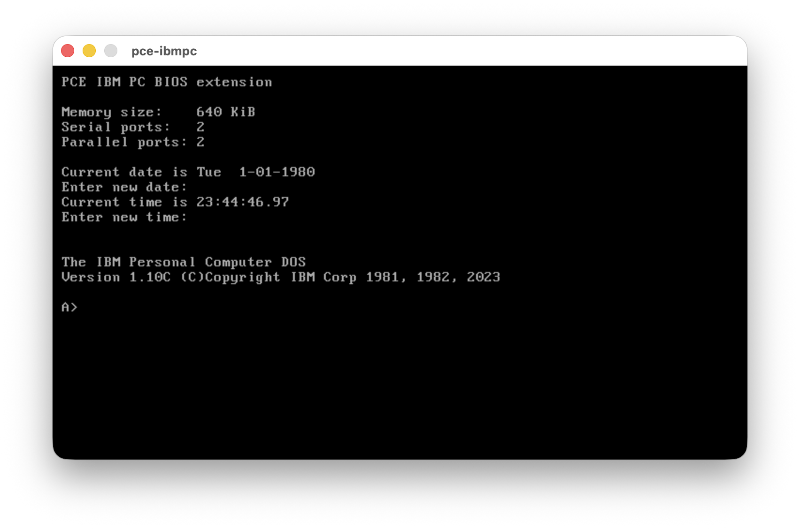
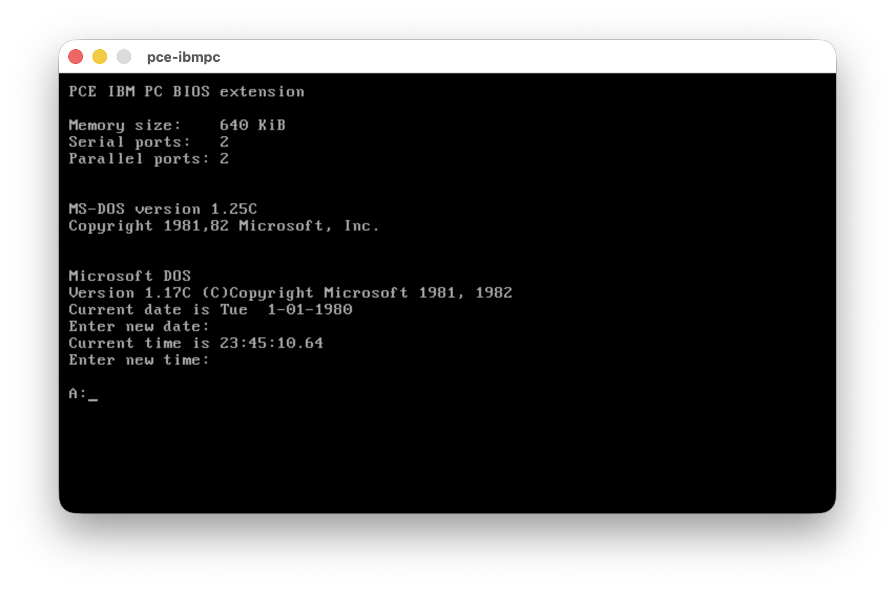
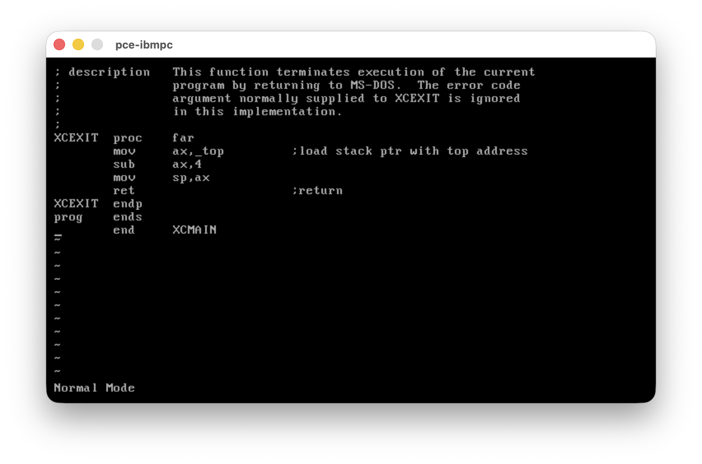
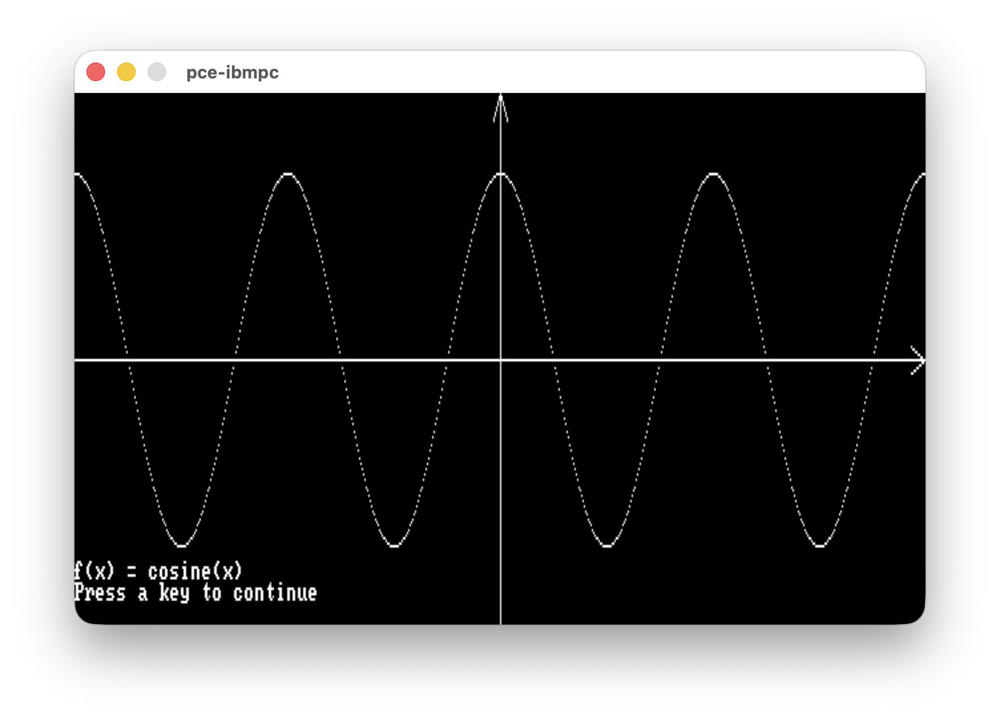
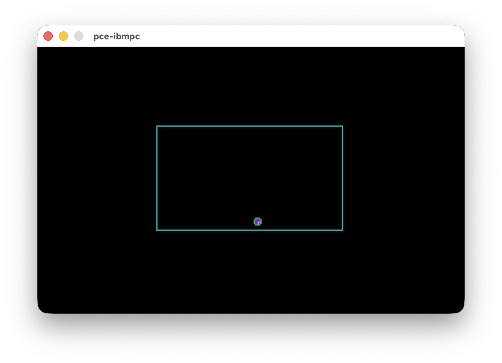
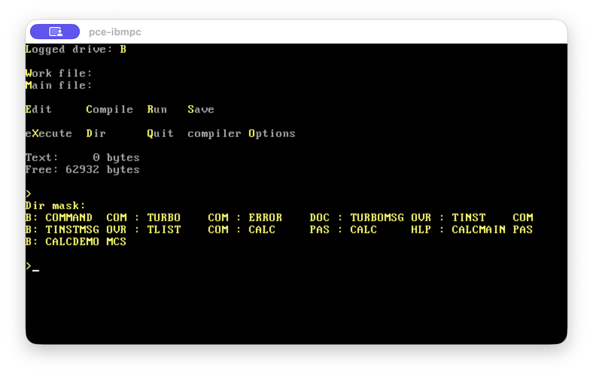

# PC-DOS 1.1 Hacking - Playing with PC-DOS 1.10 bios/dos and utilities

This project has taken the sources and binaries of PC-DOS/MS-DOS by Microsoft and creating a full source based rebuild and distribution. It contains the whole code base of pc-dos apart from basic/basica and a couple of msdos derived sources when they overlap (edlin, dos, command, format). Why? because it is fun and interesting .... 

Original MS-DOS and CP/M-86 were barely more than program launchers as kernels but provided everything to allow developers to start their journey. They are a unique piece of history and they are small enough to be understood in details.

## Screenshots

Both flavours booting under PCE/ibmpc, with the added `ver.com` command and the extended disk content:

<table>
<tr>
<td align="center"></td>
<td align="center"></td>
</tr>
<tr>
<td align="center"><b>IBM PC-DOS 1.10C</b> (<code>pcdos_full.img</code>)</td>
<td align="center"><b>Microsoft DOS 1.25C</b> (<code>msdos_full.img</code>)</td>
</tr>
</table>

As an example of applications running on PC-DOS 1.10 `vi`-like editor running on PC-DOS 1.1 (you can find the sources and binaries at ([CP/M-86 and PC-DOS 1.1 vi](https://github.com/tsupplis/cpm86-vi)). It is a port of STevie. A Screen editor is one of the missing parts of those old OSes. You can use the aztec 4.2 c compiler part of ([CP/M-86 and PC-DOS 1.1 cross development](https://github.com/tsupplis/cpm86-crossdev)) to develop, port applications to both CP/M-86 and PC-DOS 1.10 in C, Pascal or Assembler. vi.com is included in the demos.img disk image.



## Distribution Content

### Disk Images

`make` builds eight DOS floppy images, four per flavour (PC-DOS / MS-DOS),
plus `turbo.img` and `demos.img`. The DOS variants build on top of `*_base.img`.

| Image | Flavour | Content |
|-------|---------|---------|
| `pcdos_base.img` | PC-DOS | `ibmbio.com`, `ibmdos.com`, `command.com` only (minimal bootable system) |
| `pcdos_dist.img` | PC-DOS | Base + PC-DOS distribution utilities (rebuilt where available) and IBM BASIC samples |
| `pcdos_full.img` | PC-DOS | Base + distribution utilities, IBM assembler tools, IBM/Microsoft BASIC, SCP tools and `mem.com` |
| `pcdos_diag.img` | PC-DOS | Base + diagnostic utilities, including rebuilt CHKDSK/FORMAT/SYS/EDLIN and DEBUG |
| `msdos_base.img` | MS-DOS | `io.sys`, `msdos.sys`, `command.com` only |
| `msdos_dist.img` | MS-DOS | Base + the MS-DOS 1.25 style tool set and the SCP tools (`asm.com`, `hex2bin.com`, `trans.com`) |
| `msdos_full.img` | MS-DOS | Base + distribution utilities, Microsoft assembler tools, GW-BASIC, SCP tools and diagnostic helpers |
| `msdos_diag.img` | MS-DOS | Base + the small diagnostic set |
| `turbo.img` | - | Turbo Pascal 1.00A files on a formatted data disk (see [Turbo Pascal](#turbo-pascal)) |
| `demos.img` | - | Small demo programs (msbasic, vi, mem, ballc, hello80.asm, graph.bas...) |

Master (pre-formatted, empty file system) images live in `disks/`: `pcdos.img`, `msdos.img`
and `blank.img`.

### Rebuilt System Components

| Binary | Source | Description |
|--------|--------|-------------|
| `ibmbio.com`   | [ibmbio.asm](ibmbio.asm) | PC-DOS 1.1 BIOS, installed as `ibmbio.com` / `io.sys`, reconstructed sources |
| `ibmdos.com`   | [ibmdos.asm](ibmdos.asm), [dos.asm](dos.asm) | DOS kernel, installed as `ibmdos.com` (`IBMVER`) |
| `msdos.com`   | [msdos.asm](msdos.asm), [dos.asm](dos.asm) | DOS kernel, installed as `msdos.sys` (`MSVER`) |
| `ibmcmd.com`   | [ibmcmd.asm](ibmcmd.asm), [command.asm](command.asm) | PC-DOS flavour of `command.com` (`IBMVER`) |
| `mscmd.com`    | [mscmd.asm](mscmd.asm), [command.asm](command.asm) | MS-DOS flavour of `command.com` (`MSVER`) |
| `ibmsys.com`   | [ibmsys.asm](ibmsys.asm), [sys.asm](sys.asm) | `sys.com` writing the PC-DOS system files |
| `mssys.com`    | [mssys.asm](mssys.asm), [sys.asm](sys.asm) | `sys.com` writing the MS-DOS system files |

[origcmd.asm](origcmd.asm) selects the historical IBM COMMAND configuration
(`CMDEXT=FALSE`, `HIGHMEM=FALSE`) using the shared [command.asm](command.asm);
[io.asm](io.asm) is the original 86-DOS I/O system.

`DOSEXT` is an explicitly opt-in source-level demonstration extension in the
DOS wrappers.  It adds only `INT 21h` / `AH=30h`: the MS-DOS configuration
reports version 1.25 and OEM `FFh` (Microsoft), while PC-DOS reports 1.10 and
OEM `00h` (IBM); both use an unassigned serial number.  Leave it `FALSE` for
the historical dispatcher.

`edlin101.asm` also reconstructs the 86-DOS/Microsoft EDLIN 1.01 variant when
built with `MSVER`. EDLIN 1.02 changes the default `S`/`R` range: without a
starting line number, it begins after the current line rather than at line 1.

### DOS Utilities Rebuilt from Reverse-Engineered Source

These reconstructions assemble byte for byte against the originals in `reference/`.
IBM and Microsoft FORMAT share one implementation selected by their wrappers.

| Binary | Source | Description |
|--------|--------|-------------|
| `ibmedlin.com` | [ibmedlin.asm](ibmedlin.asm), [edlin101.asm](edlin101.asm) | IBM Personal Computer EDITOR (EDLIN), Version 1.00 |
| `msedlin.com`  | [msedlin.asm](msedlin.asm), [edlin102.asm](edlin102.asm) | Microsoft EDLIN, Version 1.02 |
| `diskcopy.com` | [diskcopy.asm](diskcopy.asm) | Diskette copying, including single-drive swaps and target formatting |
| `diskcomp.com` | [diskcomp.asm](diskcomp.asm) | Diskette comparison with buffered reads and geometry detection |
| `chkdsk.com` | [chkdsk.asm](chkdsk.asm) | Disk allocation and FAT12 consistency checks |
| `comp.com` | [comp.asm](comp.asm) | IBM file comparison utility |
| `mode.com` | [mode.asm](mode.asm) | Display, printer, serial-port configuration and printer redirection |
| `debug.com` | [debug.asm](debug.asm) | Debugger with memory/register editing, breakpoints, single stepping, binary/EXE loading and table-driven 8086 disassembly |
| `ibmfmt.com` | [ibmfmt.asm](ibmfmt.asm), [format.asm](format.asm), [fmtboot.inc](fmtboot.inc) | IBM format; rebuilt output corresponds to `reference/format.com` |
| `msfmt.com` | [msfmt.asm](msfmt.asm), [format.asm](format.asm), [fmtboot.inc](fmtboot.inc) | Microsoft format; rebuilt output corresponds to `reference/msformat.com` |
| `filcom.com` | [filcom.asm](filcom.asm) | Microsoft binary/text comparison with line resynchronization |
| `exe2bin.exe` | [exe2bin.asm](exe2bin.asm) | EXE-to-binary converter, preserving the complete original MZ header, relocations and trailing bytes |

The standalone boot sectors use the same loader code as FORMAT:

| Output | Configuration | Shared assembly | Reference |
|--------|---------------|-----------------|-----------|
| `ibmboot.bin` | [ibmboot.asm](ibmboot.asm) | [bootsect.asm](bootsect.asm), [fmtboot.inc](fmtboot.inc) | 512-byte sector embedded in `reference/format.com` |
| `msboot.bin` | [msboot.asm](msboot.asm) | [bootsect.asm](bootsect.asm), [fmtboot.inc](fmtboot.inc) | 512-byte sector embedded in `reference/msformat.com` |

`format.asm` includes `fmtboot.inc` directly to embed the loader. For standalone
sectors, `ibmboot.asm` / `msboot.asm` include `bootsect.asm`, which supplies the
segment, origin and encoding macros before including `fmtboot.inc`.

Run `make -B check-parity` to rebuild and compare the utilities and boot sectors.
Exact byte coverage and source locations are recorded in [mappings/](mappings/).
Missing local maps can be checked from a current MASM listing without creating
TSV files. The checker supports both EDLIN and SYS variants; IBM SYS is compared with `reference/sys.com`. Microsoft SYS reports linked
image/source verification until `reference/mssys.com` is supplied.
[tools/utility_smoke.py](tools/utility_smoke.py) also compares original and rebuilt
FILCOM/EXE2BIN output on representative emulator cases.
[tools/debug_smoke.py](tools/debug_smoke.py) checks DEBUG commands, G/T execution,
file transfers and all 256 disassembler opcode entries against the original.
These are representative execution checks, not exhaustive hardware testing.

`make check-command-reference` builds [origcmd.asm](origcmd.asm) unchanged in a
temporary directory and compares its output with
`reference/command.com`. This historical build is also part of `check-parity`;
the normal configured COMMAND build retains its enabled extensions.

### High-memory layout

`HIGHMEM` is an opt-in assembly switch in the matching DOS and COMMAND
wrappers.  It relocates their permanent portions to the top of ordinary
conventional memory; it is not the later DOS high-memory area (HMA) or upper
memory blocks.  The `H` suffix in the DOS and COMMAND banners identifies such
a build.

For the current MS-DOS build, relocation moves 6,784 bytes (424 paragraphs)
from low addresses: 5,632 bytes of DOS and 1,152 bytes of resident COMMAND.
It does not add RAM or increase the maximum DOS allocation; it makes the
program area start lower and keeps the permanent system area together at the
top of RAM.  `mem.com` reports its current PSP allocation limit rather than
mistaking relocated high-resident code for free memory.


### Added Utilities

| Command | Source | Description |
|---------|--------|-------------|
| `ver.com` | [ver.asm](ver.asm) | Reports the DOS version (external counterpart of the built-in) |
| `cls` | [command.asm](command.asm)| Clears the screen through the video BIOS (external counterpart of the built-in [command](command.asm#L201-L206) implemented in `command.com`) |
| `mem.com` | [mem.asm](mem.asm) | Reports the current DOS PSP allocation limit and BIOS conventional-memory total |
| `date10.com` | [date10.asm](date10.asm) | PC-DOS 1.0 DATE, added for Y2K compatibility: two-digit years mean 2000-2099 |
| `time10.com` | [time10.asm](time10.asm) | PC-DOS 1.0 TIME, added alongside DATE for the Y2K-compatible date/time command set |

### Samples

| Command | Source | Description |
|---------|--------|-------------|
| `hello.com` | [hello.asm](hello.asm), [hello.bas](hello.bas) | Minimal assembler and BASIC samples, built by [mkhello.bat](mkhello.bat) |
| `graph.bas` | [graph.bas](samples/graph.bas) | BASICA demo plotting `f(x) = cosine(x)` in `SCREEN 2` (640x200), with arrowed axes (`demos.img`) |
| `ball.bas`, `ballc.com` | [ball.bas](samples/ball.bas), [ballc.asm](ballc.asm) | BASICA and MASM ports of the [cpm86-hacking](https://github.com/tsupplis/cpm86-hacking) `ball.c` bouncing-ball demo, 320x200 4-color CGA (`demos.img`) |

<table>
<tr>
<td align="center"></td>
<td align="center"></td>
</tr>
<tr>
<td align="center"><b>graph.bas</b></td>
<td align="center"><b>ballc.bas / ballc.com</b></td>
</tr>
</table>

### 86-DOS Tools Rebuilt From Source

| Command | Source | Description |
|---------|--------|-------------|
| `asm.com` | [asm.asm](asm.asm) | Seattle Computer Products 8086 Assembler, Version 2.44C (SCP, Tim Paterson) |
| `hex2bin.com` | [hex2bin.asm](hex2bin.asm) | Seattle Computer Products 8086 Hex Converter, Version 1.02B (SCP, Tim Paterson) |
| `trans.com` | [trans.asm](trans.asm) | Seattle Computer Products Z80 to 8086 Translator, Version 2.21B (SCP, Tim Paterson) |
| `mon.com` | [mon.asm](mon.asm) | Seattle Computer Products 8086 Monitor, Version 1.9 (SCP, Tim Paterson / Craig Derouen) — adapted for MASM / PC-DOS |

`asm.com`, `hex2bin.com`, and `trans.com` treat the physical end of a partial FCB record as logical EOF, so their input files no longer require a trailing Ctrl-Z.

`mon.com` is the SCP ROM monitor v1.9 ported to run as a DOS `.COM` file. The original targeted
ROM at `0xFF000` with direct UART and hardware controller access; this version replaces all
hardware I/O with BIOS calls and restructures it as a relocatable COM.

| Command | Description |
|---------|-------------|
| `?` | Help — list all commands |
| `B` | Reboot — BIOS bootstrap (INT 19h), boots from first drive |
| `D [addr] [Llen\|end]` | Dump memory in hex + ASCII (default 128 bytes) |
| `E addr [bytes]` | Enter/edit memory interactively or from command line |
| `F addr Llen\|end bytes` | Fill memory with repeating byte list |
| `G [addr] [bp..]` | Go — run at address (or saved CS:IP), up to 10 breakpoints |
| `I port` | Input — read byte from port, display in hex |
| `M src Llen\|end dst` | Move — block copy (handles overlapping correctly) |
| `O port byte` | Output — write byte to port |
| `Q` | Quit — restore INT vectors, return to DOS |
| `R [reg]` | Registers — display all, or set one (`R F` edits flags) |
| `S addr Llen\|end bytes` | Search memory for byte string |
| `T [count]` | Trace — single-step N instructions, display registers after each |

All addresses and values are hexadecimal. Ranges can use an end address or `L`+length (e.g. `D 100 L20`).
`G` and `T` use the 8086 trap flag (INT 1) and INT 3 breakpoints; vectors are saved on entry and
restored on `Q`.

### Turbo Pascal

Turbo Pascal 1.00A starting up on the system:



`turbo.img` packages the files from `turbo/` on `disks/formatted.img`:

| Files | Description |
|-------|-------------|
| `turbo.com`, `turbo-87.com` | The IDE/compiler, plain and 8087 co-processor builds |
| `tinst.com`, `tinst.msg` | Installation program used to configure `turbo.com` for the target hardware |
| `tlist.com` | Cross-reference/token list utility |
| `sound.com` | Sample compiled program |
| `*.pas` | Sample sources (`art`, `calc`, `calcmain`, `cls`, `color`, `sound`, `window`, `hilb`, `test`) |
| `*.mcs` | `calc.pas` spreadsheet sample data (`calcdemo.mcs`, `sheet.mcs`) |
| `*.doc`, `read.me`, `turbo.msg` | Original documentation and help text |

### Prebuilt Binaries (`bin/`)

Vintage bootstrap/build tools and application binaries used at build time or copied onto the images.
Original DOS utility baselines are kept separately in `reference/`.

| Group | Files |
|-------|-------|
| Build chain | `masm.exe` (IBM Personal Computer MACRO Assembler, Version 2.00; PC-DOS), `msmasm.exe` (Microsoft MACRO Assembler, Version 1.10, patched; used for the build and on MS-DOS images), `link.exe` (IBM Personal Computer Linker, Version 1.10; PC-DOS), `mslink.exe` (Microsoft Object Linker, Version 1.10; MS-DOS), `lib.exe` (Microsoft Library Manager, Version 2.00; PC-DOS), `mslib.exe` (Microsoft Librarian, Version 2.00; MS-DOS), `cref.exe` (Microsoft Cross Reference, Version 1.00; PC-DOS), `mscref.exe` (Microsoft Cross Reference, Version 1.00; MS-DOS), `exe2bin.exe` (bootstrap copy; the rebuilt output is listed above) |
| Bootstrap tools | `asm.com`, `hex2bin.com`, `trans.com` |
| Original utility references (`reference/`) | `chkdsk.com`, `comp.com`, `diskcomp.com`, `diskcopy.com`, `edlin.com`, `msedlin.com`, `exe2bin.exe`, `filcom.com`, `format.com`, `msformat.com`, `mode.com`, `debug.com` (byte-exact rebuild baselines) |
| BASIC | `basic.com`, `basica.com` (IBM BASIC/BASICA, Version A1.10; require an IBM PC with the BASIC ROM, e.g. `rom/ibm-basic-1.10.rom`; PC-DOS images only), `msbasic.com` (Microsoft BASIC, Version 5.50, [Reconstructed from Microsoft Sources](https://github.com/tsupplis/cpm86-msbasic)), `gwbasic.exe` (GW-BASIC, Version 1.14; MS-DOS images only) |

### Emulation

[emu2-cpm86](https://github.com/johnsonjh/emu2-cpm86) is used for the build and tool testing. It is based on the excellent emu2 emulator, extending it both for DOS and CP/M-86 allowing development from most unix based environment. It is now part of ([CP/M-86 and PC-DOS 1.1 cross development](https://github.com/tsupplis/cpm86-crossdev).

| Item | Description |
|------|-------------|
| [pcdos.cfg](pcdos.cfg), [msdos.cfg](msdos.cfg) | PCE `ibmpc` machine configurations (5150, 8088, 128K, two floppy drives) |
| `pcdos`, `msdos` | Shell wrappers running the matching image under PCE |
| `rom/` | IBM PC BIOS 1982-10-27, IBM Cassette BASIC 1.10, EGA/VGA option ROMs and the PCE extension ROM |
| [Makefile](Makefile), [Makefile.dos](Makefile.dos) | Host (Linux/macOS, via `emu2` + `mtools`) and native DOS build scripts |

## Sources

The experiment started from the vintage MS-DOS code opened by Microsoft:

https://github.com/microsoft/MS-DOS/blob/master/v1.25/source/COMMAND.ASM

ibmbio.com sources are retrieved from https://www.os2museum.com/wp/pc-dos-1-1-from-scratch

The EDLIN sources have no upstream source. [edlin101.asm](edlin101.asm) is a
byte-exact reconstruction of IBM EDLIN 1.00 and the 86-DOS/Microsoft 1.01
variant; [edlin102.asm](edlin102.asm) is a byte-exact reconstruction of
Microsoft EDLIN 1.02.

## MIT License (In line with Source License):

- https://github.com/tsupplis/pcdos11-hacking/blob/master/LICENSE.md
- https://github.com/microsoft/MS-DOS/blob/master/LICENSE.md

- Turbo Pascal 1.00A (`turbo/`, [Turbo Pascal](#turbo-pascal) section) is not covered by the MIT license above: it is proprietary software, distributed here under Borland/Embarcadero's [Turbo Pascal museum program](https://www.embarcadero.com/free-tools/turbo-pascal), which makes it available free of charge for personal/non-commercial use.
- PCE tools are under GPL 2 license (pce directory)

## First Contact

There is a first failure on EQU symbol redefined. This prevents compilation.

```
156c156
< ZERO    EQU     $
---
> ZERO    =       $
```

To get to the official PC-DOS binary production:

A triple NOP replaces the MS instruction MOV [COMFCB],AL. This change fixes reload from command.com
on drive A: by not overriding the first FCB byte with 0 (Default drive).

```
469a474,479
>         IF IBMVER
>         NOP
>         NOP
>         NOP
>         ENDIF
>         IF MSVER
470a481
>         ENDIF
2166d2176
< 
```

The 2 previous changes allow recreation of the PC-DOS exact command.com, when MSVER is set to FALSE and
IBMVER is set to TRUE

A third small change has been added in MSVER mode, before opening the command.com file. To be checked if
this is really necessary ...

```
>         IF MSVER
>         MOV     AL, 0
>         MOV     [COMFCB], AL
>         ENDIF
```

Those variations beetween IBM and Microsoft seem to be linked to the command.com file being searched on
the default drive (Microsoft) or on drive A: (IBM).


## Little changes to the code base

- dos:
    - search path on A: if default drive seach fails
    - cls command
    - extra int 21h function 30h (dos version)
- format.com has been patched to format disk that can work with all emulators including qemu. the signature 55AA is added at the end of the 512 byte boot sector.

## Build/Test Dependencies

### Linux/macOS

- pce emulator (test) (pce tools sources are in pce, you need nasm if you wish to recompile them, my default binaries are prebuilt, pceexit and pceinit are automatically added to full and diagnostics images)
- emu2/emu2-cpm86 (for build from macosx/linux)
- pc-dos 1.1 floppy image (for test if available)
- exe2bin.exe from https://github.com/microsoft/MS-DOS/blob/master/v1.25/bin/EXE2BIN.EXE
- ibm link.exe 1.10 from https://github.com/microsoft/MS-DOS/blob/master/v1.25/bin/LINK.EXE
- microsoft masm.exe 1.10 (patched, cf below) https://github.com/microsoft/MS-DOS/blob/master/v2.0/bin/MASM.EXE

### DOS

- exe2bin.exe from https://github.com/microsoft/MS-DOS/blob/master/v1.25/bin/EXE2BIN.EXE
- ibm link.exe from https://github.com/microsoft/MS-DOS/blob/master/v1.25/bin/LINK.EXE
- microsoft masm.exe 1.10 (patched, cf below) https://github.com/microsoft/MS-DOS/blob/master/v2.0/bin/MASM.EXE

## Build

- Use Makefile on Linux, macOS
- Use Makefile.dos on Win32, DOS (builds only PC-DOS configs)

## MASM Fix

The 1.10 version of MASM part of the MS-DOS 2.00 distribution hangs on emulators, including dosbox and emu2. 

There is a detailed explanation at: https://slions.net/threads/debugging-ibm-macro-assembler-version-1-00.33/

The execution of the Faulty code looks like this:

```
11AD:0000 B83B0F           MOV     AX,0F3B
11AD:0003 8ED8             MOV     DS,AX
11AD:0005 8C062400         MOV     [0024],ES
11AD:0009 FA               CLI
11AD:000A 8ED0             MOV     SS,AX
11AD:000C 268B1E0200       MOV     BX,ES:[0002]
11AD:0011 2BD8             SUB     BX,AX
11AD:0013 81FB0010         CMP     BX,1000
11AD:0017 7E03             JLE     001C
```

The fix is just about changing the JLE into JBE (7E03 -> 7603)

```
11AD:0000 B83B0F           MOV     AX,0F3B
11AD:0003 8ED8             MOV     DS,AX
11AD:0005 8C062400         MOV     [0024],ES
11AD:0009 FA               CLI
11AD:000A 8ED0             MOV     SS,AX
11AD:000C 268B1E0200       MOV     BX,ES:[0002]
11AD:0011 2BD8             SUB     BX,AX
11AD:0013 81FB0010         CMP     BX,1000
11AD:0017 7603             JBE     001C
```

The masm binary checked in git is fixed.

--

## Companion projects

| Project | Description |
|---------|-------------|
| [cpm86-kernel](https://github.com/tsupplis/cpm86-kernel)     | CP/M-86 1.1 distribution rebuilt from patched and reconstituted sources |
| [ccpm86-kernel](https://github.com/tsupplis/ccpm86-kernel)         | CCP/M-86 3.1 distribution rebuilt from patched and reconstituted sources |
| [cdos41-kernel](https://github.com/tsupplis/cdos41-kernel)         | Concurrent DOS 4.1 distribution rebuilt from patched and reconstituted sources |
| [cpm86-crossdev](https://github.com/tsupplis/cpm86-crossdev) | Unix CP/M-86 cross development project (compilers, emulation and tools) |
| [cpm86-hacking](https://github.com/tsupplis/cpm86-hacking)   | CP/M-86 miscellaneous tools and PCE emulator helpers |
| [cpm86-cmdtools](https://github.com/tsupplis/cpm86-cmdtools) | CP/M-86 `.cmd` file manipulation tools |
| [cpm86-ports](https://github.com/tsupplis/cpm86-ports)       | CP/M-86 application ports in C and assembler |
| [cpm86-vi](https://github.com/tsupplis/cpm86-vi)             | STevie vi port for CP/M-86 and PC-DOS |
| [cpm86-msbasic](https://github.com/tsupplis/cpm86-msbasic)   | A recreaction of msbasic-86 for CP/M-86 and PC-DOS 1.1 from gwbasic sources |
| [cpm86-menu](https://github.com/tsupplis/cpm86-menu)   | A submit replacement and a menu system for submit orchestration for CP/M-86 1.1 |
| [cpm86-make](https://github.com/tsupplis/cpm86-make)   | A simple submit based make tool for CP/M-86 |
| [pcdos11-hacking](https://github.com/tsupplis/pcdos11-hacking) | PC-DOS 1.1 distribution, tools and notes |

--

## License

The whole repository is under MIT [License](LICENSE.md) unless specified otherwise in a subdirectory.
